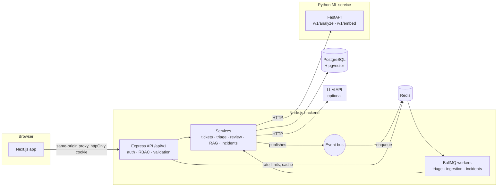
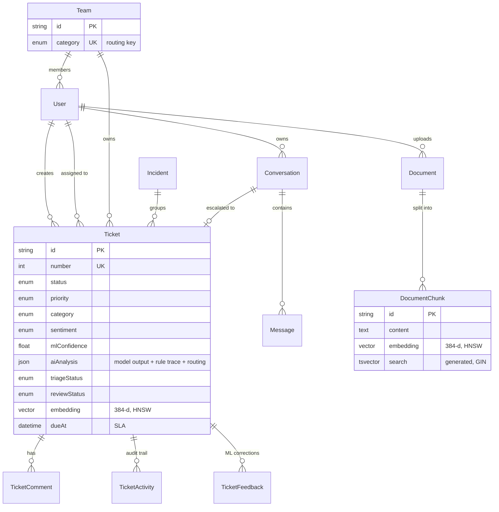

# Relay: AI-Powered Support & Incident Intelligence Platform

A support desk where machine learning drives the business workflow. Every ticket is classified, prioritised, routed and grouped into incidents automatically. Customers get a knowledge-base assistant that answers only from your documentation, with sources, and turns unanswered questions into tickets.

The **support ticket is the central entity**. The chatbot creates tickets, the ML pipeline enriches tickets, the review queue corrects tickets, and the incident detector groups tickets.

```
Customer ──► AI assistant (RAG) ──► can't answer? ──► Ticket ◄── Web form
                                                         │
                                ML analysis: category, priority, sentiment, embedding
                                                         │
                         Business rules (keywords, sentiment, repeated issues) adjust priority
                                                         │
                     Confidence ≥ threshold? ── yes ──► Route to team + least-busy agent + SLA
                                     │ no
                                     ▼
                       Human review queue ──► correction stored as TicketFeedback (training data)
                                                         │
                     Similar tickets in a short window ──► Potential incident
```

---

## Contents

1. [Problem](#problem) · 2. [Features](#features) · 3. [Tech stack](#tech-stack) · 4. [Architecture](#architecture) · 5. [ML pipeline](#ml-pipeline) · 6. [RAG pipeline](#rag-pipeline) · 7. [Incident intelligence](#incident-intelligence) · 8. [Database](#database) · 9. [API](#api-overview) · 10. [Design patterns](#design-patterns-and-principles) · 11. [Folder structure](#folder-structure) · 12. [Setup](#setup) · 13. [Environment variables](#environment-variables) · 14. [Demo accounts](#demo-accounts) · 15. [Demo walkthrough](#demo-walkthrough) · 16. [Testing](#testing) · 17. [Limitations & future work](#known-limitations-and-future-improvements)

---

## Problem

Support teams spend a large share of their time sorting work instead of doing it: reading each ticket to decide its category, urgency and owner. Urgent problems wait behind trivial ones, the same outage arrives as fifty separate tickets, and customers file tickets for questions the documentation already answers.

Relay automates the sorting while keeping humans in control:

- **ML triage** predicts category, priority and sentiment, and the backend uses those predictions to route, prioritise and set SLAs.
- **Business rules** adjust the model's priority (security keywords, angry customers, repeated issues), and every adjustment is recorded and shown.
- **A confidence gate** sends uncertain predictions to a human; their corrections become labelled training data.
- **A RAG assistant** deflects questions answerable from the docs, and escalates the rest as structured tickets.
- **Incident detection** groups similar tickets arriving together into one incident.

## Features

| Area | What it does |
|---|---|
| **Ticket triage** | TF-IDF + Logistic Regression for category and priority, VADER sentiment, sentence-transformer embeddings. Runs as a background job right after creation. |
| **Explainable decisions** | The ticket page shows the model's prediction and confidence, each business rule that changed the priority and why, and the routing decision. |
| **Routing** | Category → owning team (configurable), then the agent with the lightest open workload. SLA due date from final priority. |
| **Human review** | Below the confidence threshold, tickets wait in a review queue. Agents confirm or correct; feedback is stored for retraining. |
| **Ticket lifecycle** | Status state machine, assignment, priority changes, comments, internal notes, full activity timeline. |
| **AI assistant (RAG)** | Hybrid retrieval (pgvector + full-text), grounded answers with numbered citations, honest "I don't know", conversation history, one-click escalation to a ticket. |
| **Knowledge base** | Upload PDF/Markdown/text; async extraction → section-aware chunking → embeddings → pgvector. |
| **Incident intelligence** | Same-category embedding clusters in a time window, plus volume spike detection against a 7-day baseline. |
| **Analytics** | Volume over time, category/priority/sentiment distribution, team workload, automation rate, model agreement with agents, SLA breaches. |
| **Admin** | Users, roles, teams and their routing categories; runtime-tunable AI thresholds (no redeploy). |
| **RBAC** | Customer, Agent and Admin roles enforced on every API route and in data scoping. |

## Tech stack

| Layer | Technology | Why |
|---|---|---|
| Frontend | Next.js 15 (App Router), React 19, TypeScript, Tailwind CSS, SWR, Recharts | Server-proxied API (same-origin cookies), typed UI, small custom design system |
| Backend | Node.js, Express, TypeScript, Zod | Business logic, auth, orchestration |
| Database | PostgreSQL 16 + **pgvector**, Prisma 7 | One database for relational data **and** vectors: no separate vector DB to run |
| Jobs & cache | Redis, **BullMQ** | Async triage, ingestion and incident jobs; cache; rate limiting |
| ML service | Python, FastAPI, scikit-learn, sentence-transformers, VADER | The Python ML ecosystem, isolated behind an HTTP contract |
| LLM | Anthropic or any OpenAI-compatible API (OpenAI, Groq, Gemini, Ollama), optional | Answer generation and chat summaries; the system works without one |

## Architecture



**Why two backend services?** Node handles business logic, auth and orchestration; Python handles ML because that's where scikit-learn and sentence-transformers live. They communicate over a small, versioned HTTP contract, and the Node side depends on an `MlClient` interface, so the ML service is swappable and mockable in tests.

**Request → background flow.** Creating a ticket returns immediately (`201`). The service publishes `ticket.created`; a subscriber enqueues a BullMQ triage job; the worker calls the ML service, applies rules, routes, and publishes `ticket.triaged`, which schedules a debounced incident-detection run. Failed ML calls retry with exponential backoff; after the final attempt the ticket degrades gracefully to the General queue for a human.

### Backend layering

```
routes/        HTTP wiring: URL → middleware (auth, RBAC, rate limit, validation) → controller
controllers/   Translate HTTP ↔ service calls. No business logic.
services/      Business logic and orchestration (TriageService, ReviewService, RagService…)
domain/        Pure, framework-free rules: priority engine, SLA, policy, chunker, clustering, fusion
repositories/  The only code that touches the database (including all raw pgvector SQL)
integrations/  Adapters to external systems: ML client, LLM providers, text extractors
jobs/ events/  BullMQ queues/workers and the domain event bus
container.ts   Composition root: the one place that wires concrete implementations
```

## ML pipeline

```
title + description
      │
      ├─► TF-IDF (1-2 grams) ─► Logistic Regression ─► category + probabilities
      ├─► TF-IDF (1-2 grams) ─► Logistic Regression ─► priority + probabilities
      ├─► VADER + support-domain lexicon ─────────────► sentiment (+ compound score)
      └─► all-MiniLM-L6-v2 (384-d, normalised) ───────► embedding → pgvector
```

**Training** (`ml-service/training/`). `generate_dataset.py` builds a curated labelled dataset (4,000 tickets) whose labels match our domain: domain vocabulary × varied sentence frames × urgency cues, with 4% label noise. `train.py` trains both classifiers and saves them with metrics; models load once at startup (no retraining on boot). To use a real dataset, provide a CSV with `text,category,priority` and run `python -m training.train --data your.csv`.

**Honest evaluation.** A normal random split scored 100%, because the test set shared sentence templates with training: the model was memorising. The trainer therefore holds out **entire sentence frames** (`GroupShuffleSplit`), measuring accuracy on phrasings the model has never seen:

| Model | Accuracy (unseen phrasings) | Macro F1 |
|---|---|---|
| Category | 74.7% | 0.68 |
| Priority | 92.0% | 0.91 |

This is deliberately pessimistic; on realistic tickets the category model is usually 90%+ confident and correct. Because of that genuine uncertainty, the **confidence gate** matters: uncertain tickets go to a human rather than being mis-routed.

**Hybrid priority** (`backend/src/domain/priority-engine.ts`). The ML priority is the starting point; an ordered list of rules can only *raise* it:

| Rule | Effect |
|---|---|
| Critical keywords | "security breach", "hacked", "data loss", "fraud" → CRITICAL; "outage", "production down", "all customers" → at least HIGH |
| Negative sentiment | compound ≤ −0.5 → +1 level, capped at HIGH (anger alone never makes a ticket critical) |
| Repeated issue | ≥ 3 similar open tickets in 24 h → +1 level |

Each change is written to the ticket's `aiAnalysis.priority.trace` and shown in the UI. New rules implement `PriorityRule` and are added without touching the engine (Open/Closed).

**Feedback loop.** Every agent confirmation or correction is stored in `TicketFeedback` (predicted vs corrected category and priority, confidence, note). The admin dashboard reports **model agreement** with agents. These rows are the labelled data for the next training run.

## RAG pipeline

```
Upload ──► BullMQ job ──► extract text (PDF / Markdown / text)
                       ──► section-aware chunking ("Billing > Refund policy" + body)
                       ──► embeddings (ML service) ──► DocumentChunk.embedding (HNSW index)
                                                   ──► DocumentChunk.search (generated tsvector, GIN index)

Question ──► embed ──► hybrid candidates: top-20 by vector distance ∪ top-20 by full-text rank
         ──► Reciprocal Rank Fusion + relevance gate (semantic ≥ threshold OR keyword coverage ≥ threshold)
         ──► nothing relevant? → "I couldn't find a reliable answer" + [Create support ticket]
         ──► grounded prompt (numbered excerpts) ──► LLM ──► answer with [n] citations ──► sources
```

Design decisions:

- **Section-aware chunks.** Each heading section is its own chunk, prefixed with its heading path, so a chunk is about one topic. This fixed a real retrieval failure where a specific question matched a mixed-topic chunk too weakly.
- **Hybrid retrieval.** Embeddings capture meaning; full-text search catches exact terms (error codes, product names). Fusion uses RRF (k = 60). Both indexes live in PostgreSQL.
- **The relevance gate lets the assistant say "I don't know".** Off-topic questions return no context and never reach the LLM, which prevents hallucination.
- **Grounded prompting.** The LLM is told to answer only from the numbered excerpts, cite them, and reply `NO_ANSWER` otherwise.
- **Graceful degradation.** With no LLM configured (or if the LLM call fails), an extractive generator quotes the most relevant sentences with citations.
- **Follow-ups.** If a short follow-up finds nothing on its own, retrieval retries with the previous question as context.
- **Chat → ticket.** The LLM (or a heuristic fallback) summarises the conversation into a title and description, and the ticket goes through the normal ML pipeline. Escalation is idempotent (`409` on a second attempt).

## Incident intelligence

Deliberately compact; there is no log ingestion. It runs after triage (debounced), every 5 minutes, and on demand.

1. Take triaged tickets from the last *window* (default 60 min).
2. Per category, compute pairwise cosine similarity **in SQL** (pgvector) above a threshold.
3. Union-find clusters; the *medoid* (most central ticket) names the incident.
4. **Spike ratio** = tickets in window ÷ average per window over the previous 7 days.
5. Clusters of ≥ N tickets become (or extend) an incident. Severity grows with cluster size and spikes.
6. A volume spike with no tight cluster still raises an incident.

All thresholds are editable in **AI settings**.

## Database



Notes: roles and statuses are PostgreSQL enums; every foreign key is indexed; ticket writes and their activity rows happen in one transaction; `SystemSetting` stores admin-tunable thresholds; migrations live in `backend/prisma/migrations` (the initial one enables `vector` and creates HNSW indexes; the second adds the generated full-text column).

## API overview

Base path `/api/v1`. Auth via httpOnly cookie (browser) or `Authorization: Bearer <token>`. Errors share one shape: `{ "error": { "code", "message", "details?" } }`.

| Method & path | Role | Purpose |
|---|---|---|
| `POST /auth/login`, `POST /auth/register`, `POST /auth/logout`, `GET /auth/me` | public / any | Session (login is rate limited) |
| `GET /dashboard` | any | Role-aware summary |
| `GET /tickets` | any | Search, filter, sort, paginate (customers see only their own) |
| `POST /tickets` | any | Create; triage runs in the background |
| `GET /tickets/:id` | owner / staff | Detail, timeline, AI analysis, similar tickets |
| `PATCH /tickets/:id` | agent, admin | Status (state machine), priority, assignment, resolution |
| `POST /tickets/:id/comments` | owner / staff | Reply or internal note |
| `POST /tickets/:id/reanalyze` | agent, admin | Re-run the ML pipeline |
| `GET /review-queue`, `POST /tickets/:id/review` | agent, admin | Confirm or correct predictions (stores feedback) |
| `GET/POST /conversations`, `GET/DELETE /conversations/:id` | owner | Chat history |
| `POST /conversations/:id/messages` | owner | Ask (RAG); rate limited per user |
| `DELETE /conversations/:id/messages` | owner | Clear conversation |
| `POST /conversations/:id/escalate` | owner | Chat → ticket (idempotent) |
| `GET /incidents`, `GET/PATCH /incidents/:id`, `POST /incidents/detect` | agent, admin | Incident list, detail, status, manual detection |
| `GET /analytics/overview` | admin | KPIs and charts (Redis-cached) |
| `GET/POST /documents`, `DELETE /documents/:id`, `POST /documents/:id/reprocess` | admin | Knowledge base |
| `GET /users`, `PATCH /users/:id`, `GET /teams`, `POST/PATCH /teams/:id`, `GET /agents` | admin / staff | People and routing |
| `GET/PATCH /settings` | admin | AI thresholds |
| `GET /health` | public | DB, Redis, ML and LLM status |

ML service: `GET /health`, `POST /v1/analyze`, `POST /v1/embed` (FastAPI docs at `http://localhost:8000/docs`).

## Design patterns and principles

Patterns are used where they solve a real problem:

| Pattern | Where | Why it's there |
|---|---|---|
| **Repository** | `backend/src/repositories/*` | Isolates Prisma and raw pgvector SQL; services never write queries |
| **Service layer** | `backend/src/services/*` | Business logic independent of HTTP |
| **Strategy** | `AssignmentStrategy`, `AnswerGenerator`, `TicketSummarizer`, `TextExtractor`, `PriorityRule`; Python `Embedder`, `SentimentAnalyzer` | Swappable behaviour: LLM vs extractive answers, least-loaded vs other routing, PDF vs Markdown, MiniLM vs hashing |
| **Adapter** | `HttpMlClient`, `AnthropicProvider`, `OpenAICompatibleProvider` | One interface over external APIs; the LLM provider is an env var |
| **Factory** | `createLlmProvider`, `create_embedder`, `create_sentiment_analyzer` | Pick the implementation from configuration |
| **Chain of rules** | `PriorityEngine` | Ordered, independently testable rules that can only escalate |
| **Observer / events** | `EventBus` + `jobs/subscribers.ts` | Services publish facts; queueing is a subscriber concern |
| **Facade** | `TicketAnalyzer` (Python) | One `analyze()` over three models |
| **Composition root / DI** | `backend/src/container.ts` | Constructor injection everywhere; tests inject a fake ML client |
| **State machine** | `STATUS_TRANSITIONS` + `TicketPolicy` | Illegal status changes are rejected centrally |

SOLID and DRY in practice: controllers are thin; `TicketPolicy` holds all access rules once; `ticket_text()` is shared by training and inference so features can't drift; one embedding model serves RAG, similarity, duplicates and incidents; thresholds are configuration, not magic numbers; Zod schemas are both validation and DTO types.

**Security:** bcrypt password hashing; JWT in an httpOnly, SameSite cookie; RBAC on every route plus data scoping in services; Zod validation on body, query and params; Helmet; CORS allow-list; Redis-backed rate limits (stricter on login, chat and uploads); uploads renamed to random UUIDs with type and size limits; identical errors for unknown email vs wrong password; other users' resources return `404`; stack traces are never sent to clients; secrets only via environment.

## Folder structure

```
support-intel/
├── docker-compose.yml          PostgreSQL (pgvector) + Redis
├── backend/                    Express + TypeScript API
│   ├── prisma/
│   │   ├── schema.prisma
│   │   ├── migrations/         init (pgvector, HNSW) + hybrid_search (tsvector, GIN)
│   │   ├── seed.ts             runs the REAL pipelines over demo data
│   │   └── seed-data/docs/     knowledge-base documents
│   ├── src/
│   │   ├── config/             env (validated), constants, logger
│   │   ├── domain/             pure business rules (priority, SLA, policy, chunker, clustering, fusion)
│   │   ├── integrations/       ML client, LLM providers, text extractors
│   │   ├── repositories/       data access
│   │   ├── services/           business logic
│   │   ├── controllers/  routes/  middleware/  validators/
│   │   ├── events/  jobs/      event bus, BullMQ queues and workers
│   │   ├── container.ts        composition root
│   │   ├── app.ts  server.ts  worker.ts
│   └── tests/                  unit + API integration tests
├── ml-service/                 FastAPI + scikit-learn
│   ├── app/                    analyzer, classifiers, embeddings, sentiment, API
│   ├── training/               dataset generator + trainer
│   ├── data/  models/          dataset, trained models + metrics.json
│   └── tests/
└── frontend/                   Next.js 15
    └── src/
        ├── app/                landing, login, (app)/ dashboard, tickets, assistant, review, incidents, knowledge, admin
        ├── components/ui/      design system (button, field, modal, toast, menu, states…)
        ├── components/app/     domain components (triage readout, timeline, badges, charts…)
        ├── hooks/  lib/        session, API client, types, formatting
        └── middleware.ts       signed-out redirect
```

## Setup

### Prerequisites

- **Node.js 20.11+**, **Python 3.10–3.12**, **Docker Desktop** (for PostgreSQL + Redis)
- About 1.5 GB of disk for Python ML dependencies (PyTorch CPU)

### 1. Start PostgreSQL and Redis

```bash
docker compose up -d
```

### 2. ML service (terminal 1)

```bash
cd ml-service
python -m venv .venv
# Windows: .venv\Scripts\activate      macOS/Linux: source .venv/bin/activate
pip install torch --index-url https://download.pytorch.org/whl/cpu   # small CPU-only build
pip install -r requirements.txt
uvicorn app.main:app --port 8000
```

The trained models are included. To retrain: `python -m training.generate_dataset && python -m training.train`.
The first start downloads the MiniLM embedding model (~90 MB). On a machine without internet access, set `EMBEDDING_BACKEND=hashing` (lexical fallback).

### 3. Backend (terminal 2)

```bash
cd backend
cp .env.example .env          # Windows: copy .env.example .env  → then set JWT_SECRET
npm install                   # also runs `prisma generate`
npm run db:migrate            # applies migrations (enables pgvector)
npm run db:seed               # needs the ML service running; takes ~30 s
npm run dev                   # API on http://localhost:4000 (workers run in-process)
```

### 4. Frontend (terminal 3)

```bash
cd frontend
npm install
npm run dev                   # http://localhost:3000
```

### Useful commands

| Command | Purpose |
|---|---|
| `npm run db:reset` (backend) | Drop, re-migrate and re-seed |
| `npm run worker` (backend) | Run BullMQ workers as a separate process (set `RUN_WORKERS=false` on the API) |
| `npm run build && npm start` | Production builds (backend and frontend) |
| `npm test` (backend) | Unit + integration tests |
| `pytest` (ml-service) | ML tests |

## Environment variables

Backend (`backend/.env`, see `.env.example` for comments):

| Variable | Required | Default | Notes |
|---|---|---|---|
| `DATABASE_URL` | yes | | PostgreSQL with pgvector |
| `REDIS_URL` | | `redis://localhost:6379` | Jobs, cache, rate limits |
| `JWT_SECRET` | yes | | 16+ characters; the server refuses to start otherwise |
| `ML_SERVICE_URL` | | `http://localhost:8000` | |
| `LLM_PROVIDER` | | `none` | `none`, `anthropic`, or `openai` (any OpenAI-compatible API) |
| `LLM_API_KEY`, `LLM_MODEL`, `LLM_BASE_URL` | with a provider | | e.g. Groq or Gemini free tiers via `LLM_BASE_URL` |
| `CORS_ORIGIN`, `PORT`, `COOKIE_SECURE`, `UPLOAD_DIR`, `MAX_UPLOAD_MB`, `RUN_WORKERS`, `LOG_LEVEL` | | sensible defaults | |

ML service: `EMBEDDING_BACKEND` (`sentence-transformers` or `hashing`), `EMBEDDING_MODEL`, `SENTIMENT_BACKEND` (`vader` or `transformer`). Frontend: `API_URL` (default `http://localhost:4000`).

The environment is validated at boot with Zod, so a missing or invalid variable fails fast with a clear message.

## Demo accounts

Password for every account: **`Demo@1234`**. The login page has one-click buttons.

| Role | Email | Sees |
|---|---|---|
| Admin | `admin@demo.com` | Analytics, knowledge base, incidents, users & teams, AI settings |
| Agent | `agent@demo.com` (Priya, Billing & Payments) | Queue, review queue, incidents, ticket management |
| Customer | `user@demo.com` (Aarav) | Own tickets, AI assistant |

Other seeded agents: `arjun@`, `rahul@` (Technical), `neha@` (Account), `meera@` (Product), `kabir@` (General), all `@demo.com`.

## Demo walkthrough

A 10-minute script that shows every part of the system.

**1. Customer: the assistant (2 min).** Sign in as customer → *AI assistant* → click *"I was charged twice, when do I get a refund?"*. Point out the cited source and the "matched by" label (hybrid retrieval). Then ask *"Can I get a dedicated on-premise server for my bank?"*: the assistant says it can't answer reliably instead of inventing something. Click **Create support ticket** and open the new ticket from the header.

**2. Customer: a new ticket (1 min).** *New ticket* → title "Payment failed at checkout", description "Money was deducted but the order failed. Very frustrating!" → *Submit*. The AI triage panel fills in live: category with confidence, the model's priority, the sentiment rule raising it, usually the repeated-issue rule too (a burst of payment tickets is in progress), and routing to Billing & Payments.

**3. Agent: the queue and review (3 min).** Sign in as agent. Dashboard shows assigned tickets, SLA breaches and the review count. Open a payment ticket: walk through the three-step triage readout, the similar tickets (embedding similarity) and the incident link. Open **Review queue**: these tickets were below the confidence threshold, so no agent was assigned. Correct one; it is re-routed and the correction is stored as training feedback. Reply, then resolve a ticket.

**4. Admin: analytics, knowledge, incidents (3 min).** Sign in as admin. Dashboard: automation rate, model agreement with agents, charts. **Knowledge base**: upload a small Markdown file (e.g. "# Office hours\nThe Pune office is open for walk-in support every Friday from 10 AM to 4 PM."), watch it go from processing to ready, then ask the assistant about it. **Incidents**: the payment incident grouped 5 related tickets, with severity, average similarity and spike ratio. **AI settings**: thresholds are live configuration.

**Talking points:** ML output changes backend behaviour (routing, SLA, review gate); every automated decision is explained; humans correct the model and those corrections are training data; one embedding model powers four features; one PostgreSQL holds both relational and vector data; failures degrade gracefully (ML down → General queue; LLM down → extractive answers).

## Testing

```bash
cd backend && npm test        # 37 tests: domain unit tests + API integration tests (needs seeded DB)
cd ml-service && pytest       # 10 tests: predictions, confidence, sentiment, embeddings, validation
```

- **Unit:** priority rules (including a regression test that rules can never lower priority), chunker, hybrid fusion and relevance gate, RAG prompt construction and citations, extractive answers, incident clustering, spike ratio, severity, SLA, access policy, status state machine.
- **Integration (real Express + PostgreSQL, fake ML client injected via the container):** auth and enumeration-safe errors, httpOnly cookie, RBAC and data scoping, validation errors, confident triage → team + agent + sentiment escalation, low confidence → review queue → correction → re-routing + feedback, state machine, internal notes hidden from customers, chat escalation idempotency, conversation privacy.

## Known limitations and future improvements

**Limitations (honest):**
- The classifiers are trained on a curated synthetic dataset; real performance needs real tickets. The feedback table is designed to collect exactly that data.
- Without an LLM, answers are extractive (quoted sentences): accurate and cited, but less fluent. Exact-number questions (e.g. "error 429") rely on keyword overlap in that mode.
- Lists refresh by polling (SWR), not WebSockets.

**Future improvements:**
- Scheduled retraining from `TicketFeedback`, with model versioning and A/B evaluation before promotion.
- A fine-tuned transformer classifier compared against the TF-IDF baseline.
- Streaming chat responses (SSE) and real-time queue updates.
- A cross-encoder re-ranker for RAG and an offline retrieval evaluation set.
- Suggested replies for agents, drafted from similar resolved tickets and the knowledge base.
- Email and Slack notifications via the existing event bus; multi-tenant workspaces.
